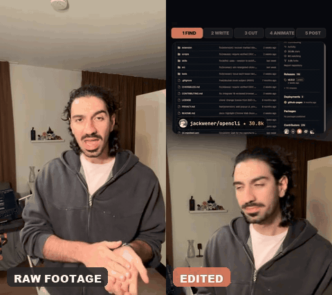
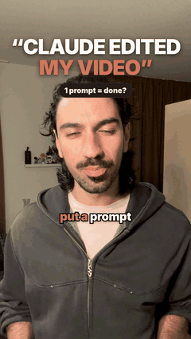
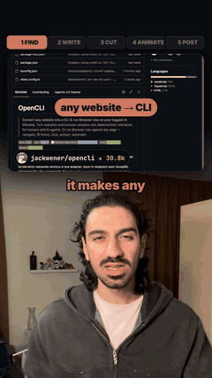
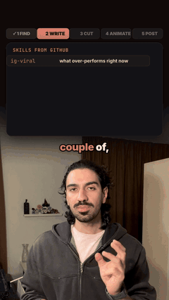
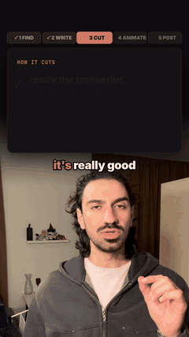
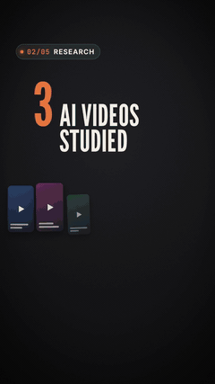

# Claude Code content setup

This is how I make Instagram Reels and TikToks without leaving Claude Code, even though I have zero editing experience. It works two ways:

- **Your footage:** film yourself talking, and Claude finds what's working, writes the hook and script, cuts the video, adds the visuals and writes the caption.
- **Faceless:** motion-design videos with an AI voiceover, or carousels. Good for a product or a brand.

## What it made

**Your footage.** My raw iPhone take on the left, the same moment after Claude Code edited it on the right: the cut, the grade, captions and an on-screen card explaining what I'm saying.

More from the same reel:

| Hook and captions | Research, explained on screen | Skills popping in | The cutting step |
| --- | --- | --- | --- |
|  |  |  |  |

**Faceless.** A motion-design video with an AI voiceover, no footage at all:

## How to use it

Open Claude Code (or your coding agent) and paste:

> Read https://github.com/nstavr04/make-content/blob/main/AGENT.md and set it up for me.

Your agent reads [AGENT.md](AGENT.md), installs the tools with you one at a time, and saves the workflow as a skill. After that, just say "make a reel about <your idea>".

## What's inside

| Step | Tool |
| --- | --- |
| Find reels that are working right now | [OpenCLI](https://github.com/jackwener/OpenCLI) + [ig-viral](https://github.com/Jakeschincariol/instagram-agent-skill) |
| Hook and script | [ig-reel](https://github.com/Jakeschincariol/instagram-agent-skill), [viral-hooks + storytelling](https://github.com/artemnovitckii/content-skills) |
| Cut your footage | [Video Use](https://github.com/browser-use/video-use) + [ElevenLabs](https://elevenlabs.io) transcription |
| Visuals and faceless videos | [HyperFrames](https://github.com/heygen-com/hyperframes) |
| Schedule the post | [Postiz](https://github.com/gitroomhq/postiz-app) |

AGENT.md also includes what I learned about making the edit feel natural, not rushed.

You'll need an ElevenLabs API key for the best transcription and for voiceovers. Without one, it can use a free local Whisper, with a slightly rougher cut.

The research step lets your agent browse Instagram and TikTok as you. That's a bit of a gray area under their terms, so use it at your own risk.

Your first videos might take a couple of rounds to get right. With a good prompt and clear direction, mine are now mostly one shot.
